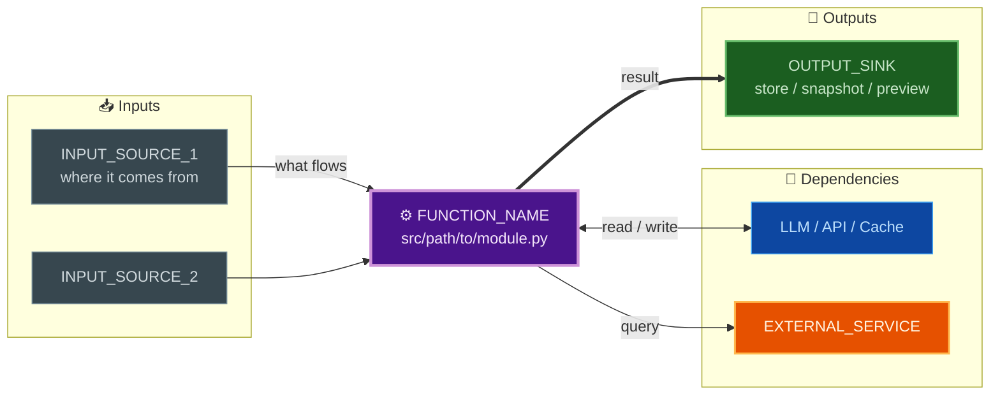

# TEMPLATE: Your Function Name

**Copy this file** to create a new diagram piece (e.g., `01-your-function.md`).

One function = one hub = one piece. The function is the STAR center; its inputs, dependencies, and outputs radiate as spokes.

---

*Rendered natively by MkDocs Material (Mermaid). This piece is the source of truth; the interactive
[Architecture Diagrams](../../architecture_diagrams.html) viewer is generated from it by
`noit-diagram-rollup build`.*
